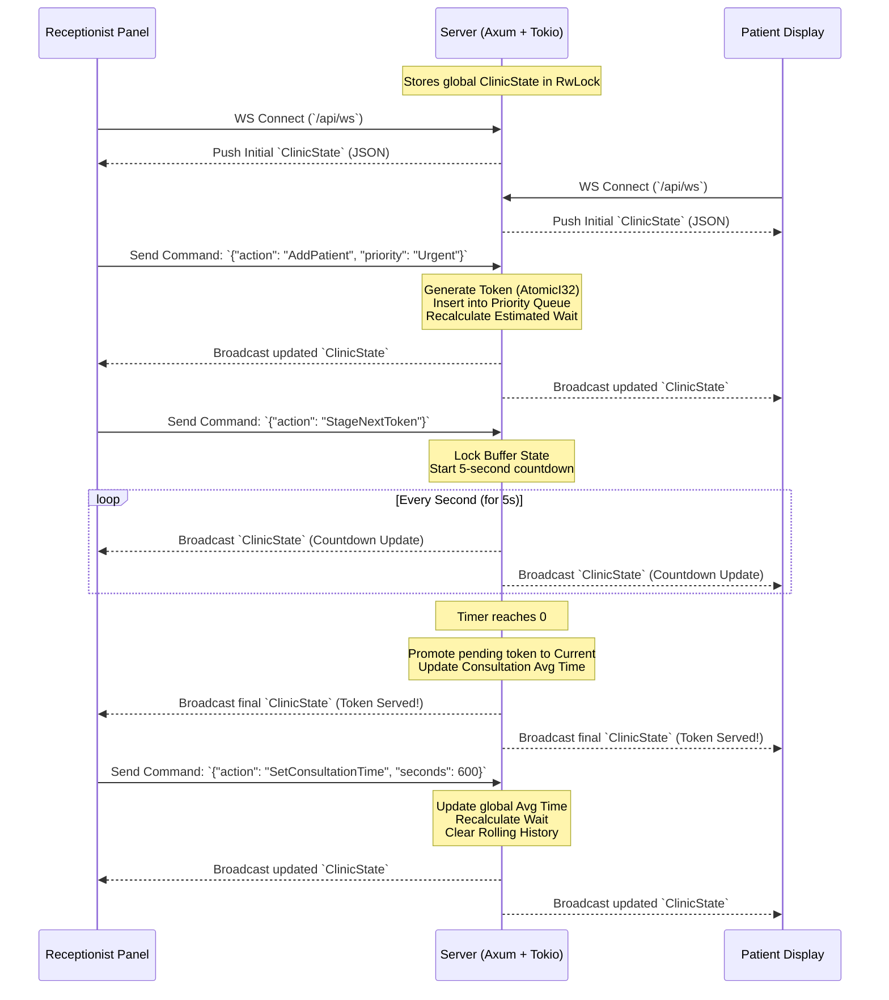

# Socket Event Diagram

This document outlines the real-time communication flow over WebSockets between the **Receptionist Panel**, the **Backend Server**, and the **Patient Display**.

---

## Architecture Flow



---

## Command Payloads (Client -> Server)

When an action is triggered on the Receptionist Panel, a command payload is sent over the WebSocket channel:

| Command Action | Description | Payload Schema |
| :--- | :--- | :--- |
| **AddPatient** | Enqueues a new patient | `{"action": "AddPatient", "priority": "Regular" \| "Urgent"}` |
| **RemovePatient** | Dequeues a patient | `{"action": "RemovePatient", "token": 12}` |
| **StageNextToken** | Locks buffer and starts 5s countdown | `{"action": "StageNextToken"}` |
| **CancelNextToken** | Cancels the staging buffer countdown | `{"action": "CancelNextToken"}` |
| **SetConsultationTime** | Sets manual consultation time override | `{"action": "SetConsultationTime", "seconds": 900}` |

---

## State Payload (Server -> Client)

Every time the state changes (via receptionist command or buffer countdown tick), the server broadcasts the full updated `ClinicState` JSON object to all clients:

```json
{
  "current_token": 12,
  "active_consultation_start": "2026-06-24T14:30:00Z",
  "estimated_wait_time_secs": 1800,
  "average_consultation_secs": 600,
  "upcoming_queue": [
    { "token": 13, "priority": "Urgent" },
    { "token": 14, "priority": "Regular" }
  ],
  "buffer_state": {
    "is_locked": false,
    "seconds_remaining": 0,
    "pending_token": null
  },
  "total_served": 11
}
```
